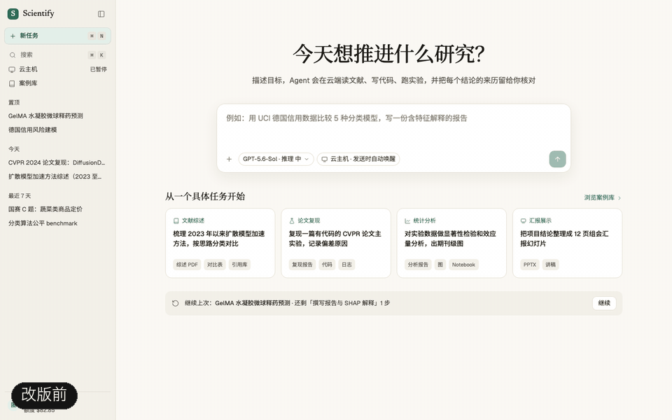
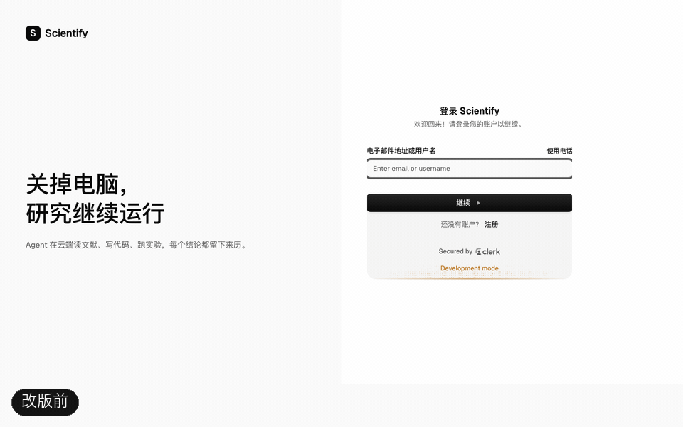
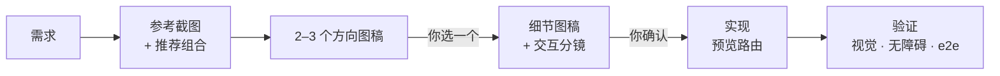

# design-skills

让 Claude Code 像设计师一样做界面：**先找参考、出图稿给你确认，再写代码，最后逐项验证。**

两个 skill 来自 [Scientify](https://scientify.tech) 官网与应用的一次完整改版，规则都是实际踩坑后写下的。

## 改版效果

下面都是真实界面截图，左侧「改版前」，擦除后为「改版后」。

### 官网首页

首屏是一个会动的产品窗口：输入研究问题、逐步执行、交付报告，窗口随指针倾斜、随滚动放平。


### 应用首页

从绿色主题改为单色体系，统一面板、字号与胶囊按钮，加入「继续上次」与案例快捷入口。



### 登录页

左右分栏改为居中单卡片，字母占位 logo 换成品牌 logo，Clerk 表单样式与中文文案本地化。



## 包含的 skill

| Skill | 做什么 | 什么时候触发 |
| --- | --- | --- |
| [`website-design`](skills/website-design/SKILL.md) | 官网、落地页、应用界面、登录页的端到端设计流程 | 「重新设计官网」「这个页面太割裂」「给工作台找点参考」 |
| [`image-gen`](skills/image-gen/SKILL.md) | 通过 OpenAI 兼容中转调用 GPT Image 出图，无依赖 Node 脚本 | 需要图稿、插画、图标、背景时；`website-design` 出图稿也用它 |

## 工作流程



每一步都有闸门：没确认的图稿不写代码，没通过验证不提交。

### website-design 的要点

- **页面系统**：整页统一一种背景、一个区块模块、一套字号，解决「割裂感」。具体取值来自确认过的图稿。
- **美术方向**：立体感和动效从需求推导，先出 2–3 个方案再落地，不套用固定配方。
- **丰富交互**：每个交互状态都要有反馈，优先用现成组件；组件库和动画库按项目挑选，附选库标准与候选。
- **参考资料**：画廊、真实产品界面库、组件源清单，以及截图挑选参考的方法。
- **踩过的坑**：对比度、动画导致的无障碍问题、移动端溢出、i18n、品牌 logo、Clerk 登录页样式。

文件结构：

```
skills/
├── website-design/
│   ├── SKILL.md                    流程、页面系统、美术方向、选库原则
│   └── references/
│       ├── ui-references.md        参考站、交互模式对照、截图方法
│       ├── draft-prompts.md        图稿提示词模板
│       ├── build-patterns.md       选库、动效实现、品牌 logo、登录页
│       └── verification.md         视觉、无障碍、e2e、构建检查
└── image-gen/
    ├── SKILL.md
    ├── config.example.json
    └── scripts/gen.mjs
```

## 安装

```bash
git clone https://github.com/WithZeng/design-skills.git ~/Documents/design-skills
ln -s ~/Documents/design-skills/skills/website-design ~/.claude/skills/website-design
ln -s ~/Documents/design-skills/skills/image-gen ~/.claude/skills/image-gen
```

用软链接安装，`git pull` 后立即生效。新开一个 Claude Code 会话，说「帮我重新设计官网首页」即可触发。

## 配置 image-gen

1. 复制 `skills/image-gen/config.example.json` 为 `config.json`（已被 gitignore），填入默认模型、中转站域名、每次请求的价格和 `defaultBudget`。
2. 凭据放在 `~/.config/image-gen/` 下的环境变量文件，或用 `IMAGE_GEN_ENV` 指向自己的文件，变量为 `OPENAI_BASE_URL` / `OPENAI_API_KEY`（备用 `_2` … `_4`）。凭据不要放进本仓库。
3. 免费查看各中转站可用的模型：`node skills/image-gen/scripts/gen.mjs --models`。

花费上限取 `--budget`，不传时取 `defaultBudget`；所有请求记录在 `~/.config/image-gen/requests.jsonl`。

## 说明

- 对比图里的界面属于 Scientify，仅用于展示 skill 的效果。
- 参考站的价格和可访问性记录于 2026-10，使用前请自行核实。
