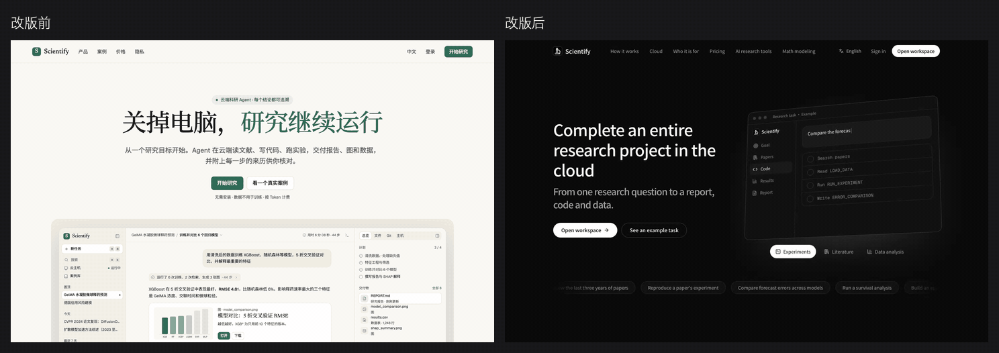
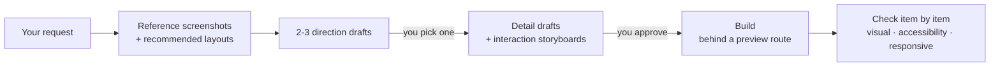

# design-skills

**English** | [简体中文](README.zh-CN.md)

Stop Claude Code from writing frontend code blind.

The biggest pain with AI-written pages: **it has no idea what its output actually looks like**. Sections don't match each other, font sizes jump around, the palette screams cheap template, and two rounds of edits later everything falls apart.

These skills distill the rules we learned while rebuilding a real product's website and app: **they make Claude work like a proper designer — find references first, generate design drafts with an image model for you to pick a direction, write code only after you approve, then verify everything item by item.**

## Real redesign

Before and after of the website homepage. The new hero is a live, interactive product window: type a research topic, watch it run step by step, and get the analysis report.



## What's inside

| Skill | What it does | When it triggers |
| --- | --- | --- |
| [`website-design`](skills/website-design/SKILL.md) | End-to-end design and build for websites, landing pages and app/admin screens | "Redesign this page", "this dashboard looks bad", "find good references for the workbench" |
| [`image-gen`](skills/image-gen/SKILL.md) | Generates images with GPT Image models through OpenAI-compatible relays; a plain Node script with no extra dependencies | Illustrations, icons, backgrounds, or design drafts for review during the design flow |

## How it works



One hard rule: **no code before the drafts are approved, and no commit until the build matches them.**

### Problems website-design solves

- **No patchwork look**: one base background, one section module and one type scale across the page, so sections don't look like they came from five different templates.
- **Purposeful motion**: motion and depth follow the product's interactions, built on mature animation libraries — no cheap, flashy effects.
- **Feedback everywhere**: hover, loading, empty states and mobile layouts are all covered, matching the interaction standard of real products.
- **Lessons learned**: built-in rules for contrast compliance, reduced motion, mobile overflow, multilingual copy, and styling third-party auth pages (e.g. Clerk).

Layout:

```
skills/
├── website-design/
│   ├── SKILL.md                 # workflow, design rules, library selection
│   └── references/
│       ├── ui-references.md     # reference sites, interaction patterns, capture method
│       ├── draft-prompts.md     # prompt templates for design drafts
│       ├── build-patterns.md    # library choice, motion implementation, auth pages
│       └── verification.md      # visual, accessibility and responsive checklist
└── image-gen/
    ├── SKILL.md
    ├── config.example.json
    └── scripts/gen.mjs
```

## Install

Install with symlinks so a `git pull` takes effect right away:

```bash
git clone https://github.com/WithZeng/design-skills.git ~/Documents/design-skills
ln -s ~/Documents/design-skills/skills/website-design ~/.claude/skills/website-design
ln -s ~/Documents/design-skills/skills/image-gen ~/.claude/skills/image-gen
```

Then just tell Claude Code "redesign our website homepage" to trigger it.

## Configure image-gen

1. Copy the config and fill in your relay hosts, default model, price per request and default budget `defaultBudget`:

   ```bash
   cp skills/image-gen/config.example.json skills/image-gen/config.json
   ```

2. Set the API key (never commit it): put an env file under `~/.config/image-gen/`, or point `IMAGE_GEN_ENV` at one, with `OPENAI_BASE_URL` and `OPENAI_API_KEY` (add `_2` … `_4` as backup relays; the script falls back to them when the primary fails).

3. List the models each relay offers:

   ```bash
   node skills/image-gen/scripts/gen.mjs --models
   ```

Cap spend per run with `--budget`; without it the script uses `defaultBudget`. Every request is logged to `~/.config/image-gen/requests.jsonl` for reconciliation.
